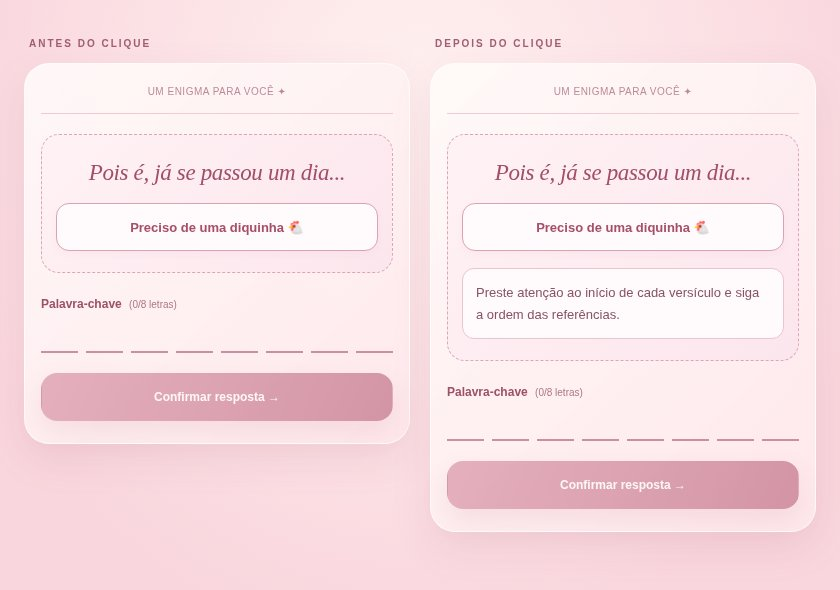

# Prévia da dica após 24 horas

Texto: “Pois é, já se passou um dia...”

Botão: “Preciso de uma diquinha 🐔”

Ao clicar: “Preste atenção ao início de cada versículo e siga a ordem das referências.”

Para testar o botão, baixe o arquivo index.html desta pasta e abra-o no navegador. O HTML é independente e não se conecta ao Supabase. O cronômetro mostrado é ilustrativo.

Esta branch contém somente arquivos de prévia. Nenhum arquivo do aplicativo ou do banco foi alterado e esta prévia não foi integrada à main.
